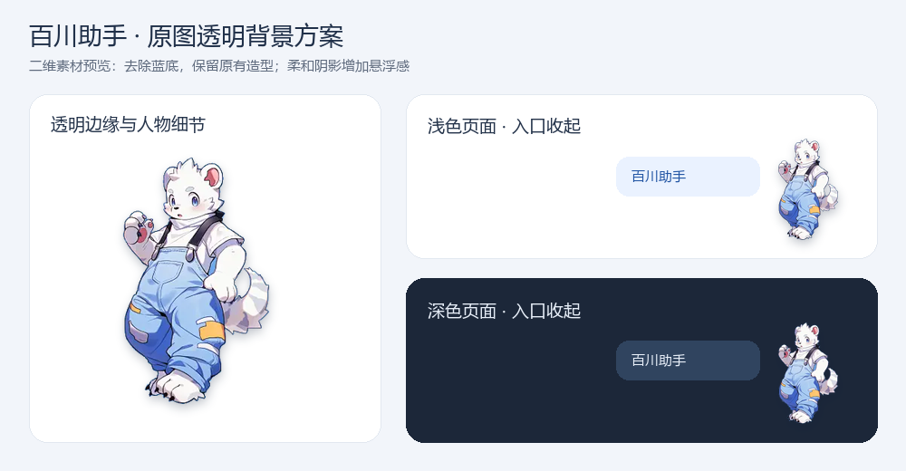

# 角色视觉素材

用户参考：白色拟人虎形象、浅蓝背带裤、黄色补丁、招手姿势。首期沿用原图，不依赖图片生成服务、3D 模型购买或新的 API Key。

| 文件 | 用途 |
| --- | --- |
| [reference-original.png](reference-original.png) | 用户原始参考的归档副本 |
| [baichuan-mascot-transparent.png](baichuan-mascot-transparent.png) | 带透明通道的通用资源 |
| [baichuan-mascot-transparent.webp](baichuan-mascot-transparent.webp) | 无损 WebP 页面候选资源 |
| [mascot-presentation-preview.png](mascot-presentation-preview.png) | 浅色/深色背景下的软阴影呈现预览 |
| [asset-notes.json](asset-notes.json) | 尺寸、去背景方式和用途记录 |

素材由前序本地处理结果归档：确定性移除与边界相连的蓝色背景，保留衣服颜色，透明图片尺寸 219×353。建议页面显示高度约 110 CSS px，宽度按比例；不把 240×341 的原图强行放大为大幅角色。

它是二维透明素材，立体感来自阴影与交互，不是实际三维模型。正式接入时使用真实图片和 CSS，不能用纯色占位图替代验收；最终位置与遮挡仍需 AI-AC01 的真实页面验证。

