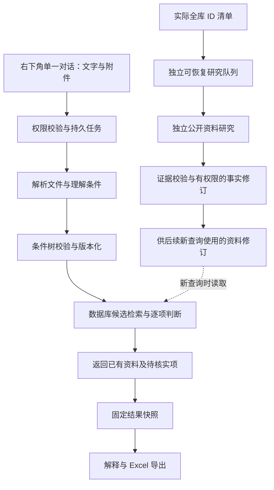

# 技术方案

AI-D40 GitHub交付完成：用户明确允许在现有公开仓库公开企业数据，代码/SDD/测试与企业快照已上传独立分支 `codex/baichuan-delivery-20261018`。已从GitHub核对2178个发布路径、1768个数据文件对象，抽取企业/旧资质/人员JSONL、清单、校验收据及原Excel/网页归档共7个文件实际下载回读，字节一致；其余文件以完整Git Blob对象ID逐一绑定原始字节，未冒充全部下载。包含1283企业、1460旧资质、1622证书，9表25843条、4064来源路径/1754去重归档。前端163项、5进程、全部现用业务/任务/来源与原试运行库保护通过；0写库/0模型/0补全/0正式部署。账号密钥、会话、对话、招标附件及完整运行恢复包未上传。 [公开交付证据](evidence/AI-T17/2026-10-18-d40-github-public-delivery.md)。


AI-D39部署前当前范围完成（2026-10-18T21:00:40.390306+08:00）：用户明确尚未到正式部署阶段，本轮未部署。新增Chrome for Testing155.0.8059.84与Firefox157原页面补验：两角色各4视口，另Firefox原生关闭blur能力，共24组视口/6组触屏仿真通过；两浏览器四组角色的原结果恢复、文件选择与移除、既有Excel下载及刷新通过。portal93表+platform6表、18451文件/1131103415B备份与恢复副本哈希一致；两角色密码/绑定/权限/结果/既有Excel及36份附件实际回读通过。0应用源码改动、0新查询/模型/导出生成、0构建/服务重启，163当前前端指纹与全部资料保持。D38的617项/前端16项为输入未变的历史有效检查，本轮不冒充重跑。真机、Safari、物理输入法及新机器整机冷恢复未执行；速度/资料补全继续按用户要求延期，不是当前交付前置项。 [本轮证据](evidence/AI-T17/2026-10-18-d39-predeployment-browser-and-full-restore.md)。

以下保留历史；当前交付状态以D39为准。

AI-D38本地交付收尾完成（2026-10-18T20:29:09.533178+08:00）：47模块617项新回归PASS/322.841s/0skip/87输入；前端16项、TypeScript及助手ESLint通过。Edge双角色1920/1440/768/390共8视口、键盘焦点、可信浏览器组合输入及减少动画通过；支持范围为本机Edge，物理输入法候选窗口、Chrome/Firefox和原生无blur环境未验收。断网中文提示与保留草稿、恢复不自动发送、丢响应同键重提只产生一个任务、观察断流后任务继续、损坏PDF明确失败及原页面关联重试/显式文字替代/刷新恢复通过。修复损坏/加密等内容错误未进入未读附件恢复协议的缺口，基础设施/安全/限额错误仍独立保留。仅备份加载所属portal/worker（2026-10-18T20:24:31.910292+08:00），原前端21632与两网关保持，161其他冻结文件/CSS/布局/入口及原资料保持；93表在线备份与恢复副本全结构/全行摘要一致。速度和资料补全按用户要求延期，远程未操作；并非原SDD全浏览器/整机灾备全部通过。 [本轮证据](evidence/AI-T17/2026-10-18-d38-final-local-handoff.md)。

以下保留历史时点；当前范围以上述D38为准。

AI-D37最新交付边界：用户明确“速度这方面跳过”，停止继续速度优化，并将全查询5秒及完整性能目标从当前本地机器人交付门槛移出；历史未达标和实测证据保留，状态为用户延期，不写PASS。超时/限流/有限重试/并发/幂等/安全保护继续有效；独立信息补全仍延期。当前咨询剩余交付工作，只记录核对结果，未授权或执行新的页面外观改动、浏览器安装、远程部署或全组重启。现有D36核心链路证据保持；下一步为明确实际支持的浏览器/视口与输入操作、必要原页面异常补验、统一最新版本/备份/恢复与最终分项验收，非重做全部已有测试。

以下保留各轮历史证据，以本条最新交付边界为准。

最新执行优先级：AI-D27跳过独立信息补全，AI-D28旧资质库按用户确认作为可信检索依据。下文旧“源表声明不得确认”仅保留历史策略，当前由AI-D28受控策略替代。

所属本地 `local_dev.py` 只在source_connected时显式设 `PORTAL_BAICHUAN_TRUST_LEGACY_QUALIFICATIONS=1`，全局默认false。`company_facts`冻结当前旧表记录及信任日；`baichuan_legacy_matching.py`结合既有规则与证据进行确定匹配，优先显式冲突，不写证书verification_status。未录/未知、错主体、明确失效或指定日期缺依据不继承满足。名称/地区使用现有非空字段；导出沿用固定结果快照与默认confirmed路径。163前端保持，已按[本轮机器人检索证据](evidence/AI-T15/2026-10-18-trusted-legacy-robot-retrieval.md)完成实际回归和两角色原UI检索。

AI-D20研究模型策略：境内企业的名称理解、官网线索分析和资料提取优先使用现有可用国产中文模型。2026-10-17只读核查当前product_assistant已配置`qwen3.8-flash`；本次未调用或改路由。模型服务与搜索来源发现分别验证，不能把模型已配置当成联网检索已接通。官网和字段仍须实际正文、主体、定位及版本校验；已知HTTP站点而HTTPS失败的情况另记读取/维护能力缺口，不猜测HTTPS或关闭TLS校验。

AI-D24维护工具增量：实际读取的HTTP企业自有页面经原有全文/主体/hash/定位检查后可保留原协议，官网声明须同scheme/host/默认port，HTTP仅限显式corporate并记未加密传输；自动获取器的连接/DNS/跳转策略不变。先隔离检查，真实查询保护窗口内不改核心模块；已存非空、旧冻结批次与证据保留。

本方案是待实施设计，表名、接口和目标参数在对应任务验证后冻结；不能据此声称功能已经存在。

2026-10-17执行约束更新（AI-D16）：用户最新要求不要修改页面前端，当前前端工作区冻结。继续后端、资料、来源与隔离验证，保留既有前端差异及服务；原计划涉及后续页面/样式实现的部分不再执行，未完成UI验收不能据后端通过补记。

## 1. 现有代码衔接

基线提交：`ef1676cd8327d693dab897c45a234ba91413884e`，实施时重新读取 HEAD 和工作区，不要求退回此版本。

| 现有位置（相对仓库根目录） | 已有能力 | 扩展方式 |
| --- | --- | --- |
| `frontend/src/business/product/Baichuan.tsx`、`Baichuan-data.ts`、`Baichuan.css` | 列表、筛选、详情、滚动恢复 | 在百川页面挂载助手，保持现有筛选行为 |
| `frontend/src/business/product/CompanyEditor.tsx` | 新增/编辑及版本化提交 | 兼容证据和证书修订，不清除后台补全成果 |
| `frontend/src/business/api.ts` | 业务 API 客户端与代理衔接 | 复用登录、错误处理，不绕过现有入口 |
| `services/business/backend/portal/baichuan_models.py` | 公司、七类资质、公开人员 | 增量添加证据、通用证书、任务及结果模型 |
| `services/business/backend/portal/baichuan_service.py` | 权限、精确等级、事务及版本比较 | 复用边界；新增受校验的条件编译和事实修订服务 |
| `services/business/backend/portal/baichuan_urls.py`、`baichuan_api.py` | 公司列表/详情读写 | 在既有 `/api/product/baichuan/` 下增加专用接口 |
| `services/business/backend/portal/model_gateway.py` | 现有模型调用路由 | 复用配置、预算与调用记录，不在前端放密钥 |
| `services/business/backend/portal/product_worker.py` | 持久任务、租约、fence、检查点 | 借鉴并提取适用机制，不把百川任务伪装成文档生成任务 |
| `services/business/backend/portal/product_assistant_runtime.py` | 通用助手运行策略 | 保持其通用限制，新业务单独注册受控工具与提示词 |
| `services/business/backend/portal/baichuan_import.py` | 旧 Excel 解析与初始化核对 | 仅在维护核对中复用，不添加普通用户自动覆盖导入 |

当前七类等级字段和数据库约束较固定，不适合直接塞入所有新证书。现有 `PRESENT/ABSENT/UNKNOWN` 描述是否持有，不能替代“来源已核实”和“在指定日期有效”。这是本轮增量调整的主要原因。

### 1.1 原始名录接续（AI-D14）

用户提供多工作表原件后，先校验指纹、首行标题/次行表头、总表与分类表多重集合；只从总表归一企业，不重复导入分类视图。名称仅处理空白和中英文括号，源名称/行号/资质/电话说明全部保留。原表没有明确字段时不猜信用代码、官网、联系人、证书日期；劳务信誉标签不作资质等级，CCRC未明确安全集成的条目仅留原声明。

规范化输出在私有运行目录留存；复用 `convert_source` 和 `preview_import/apply_import`。仅本任务所属本地空库，先一致性备份、检查预检零错误，再经维护身份新增；同一清单重跑必须新增0，已有值冲突则拒绝整批。保留已有会话、权限和源文件。来源原文与未核实标记可见，新规则匹配不能把legacy源表声明直接当已确认匹配。历史研究库尚缺的范围单独报告。

## 2. 请求流水线



对话请求、全库补全和导出各有独立任务；共享规范化事实及证据缓存，不共享私人会话。数据库查询与规则判断不依赖模型逐家公司阅读。

独立资料修订不推进当前用户查询，也不改旧快照。查询完成状态不因独立研究不可达而变为partial。

Excel证号链路补齐：匹配时从当前已授权、正确企业与scope的证书/证据记录冻结所需证号及主体/类别/等级/日期/核实元数据，随新结果快照持久化；导出仅使用该固定记录，并与自身企业、来源ID关联，使用文本单元格及既有公式防护。旧快照缺证号保持空白，不从当前证书表追读。新增测试覆盖前导零、公式文本、未核实标记、其他主体/scope隔离、证书修改后旧快照/文件不变；前端冻结。

## 3. 增量数据结构

### 3.1 保留与新增

保留 `Company`、`CompanyQualification`、`CompanyPerson` 和既有 ID，既有手工筛选的七类及精确等级语义不变。新增模型先在隔离库验证；迁移编号实施时根据当前叶节点确定，不预占可能已被其他改动使用的编号。

| 新增概念（建议模型名） | 主要字段与约束 |
| --- | --- |
| `BaichuanEvidence` | URL/导入来源、发布者、标题、获取时间、发布/核验日期、内容哈希、摘录与页/段定位、主体识别结果、可访问状态；同一来源支持多个事实引用 |
| `BaichuanFactRevision` | 公司 ID、字段/对象 ID、旧新声明、关联证据、提出者/执行身份、基线版本、审核/核实状态、变更原因；追加式历史 |
| `BaichuanCertificate` | 公司及实际持有人、类别代码或原始类别、标准/范围、等级原文/规范值、证号、颁发方、起止日期、撤销/暂停信息、核实状态、来源修订；允许同企业同类别多证 |
| `BaichuanQualificationRule` | 类别、别名、合法等级、显式等级关系、适用标准/日期、规则依据、版本、启用状态；没有规则的类别仅保留声明 |
| `BaichuanConversation` / `BaichuanMessage` | 部署/业务范围、所有者、条件版本、授权附件引用、消息与任务引用；跨会话附件不可借 ID 读取 |
| `BaichuanJob` / `BaichuanJobItem` | 类型、所有者/执行身份、状态、阶段、预算、幂等键、租约/fence、检查点、尝试次数、真实计数、错误码和结果引用 |
| `BaichuanMatchSnapshot` | 条件树与版本、规则版本、候选与结果 ID、各硬条件判断及证据修订、事实截止时间、结果修订号；导出绑定不可变版本 |
| `BaichuanResearchManifest` | 范围、创建时间、固定企业 ID/版本、总数、后续增量、每家公司各字段的研究与核验状态 |
| `BaichuanExport` | 所有者、快照 ID/修订、所选范围与字段、文件哈希/存储引用、生成时间、有效期和授权信息 |

原文件/网页快照存放受权限控制的运行存储，不提交 Git；Git 只保存脱敏证据索引和开发检查记录。

### 3.2 新旧事实兼容

1. 老资质记录作为历史声明保留；能够追溯的已核实来源保留其核实状态，无来源定位的记录不凭空升级。新增证书记录引用旧记录 ID 或来源修订，记录转换映射。
2. AI 匹配优先用通用证书记录及其有效证据；仅有旧 `PRESENT` 声明但缺关键依据时可进入待核实候选。既有手工筛选仍按原始精确规则工作，页面明确两种结果的核实口径。
3. 已核实的新证书通过统一维护服务更新七类兼容投影；该投影不独立生成第二套事实，映射可追溯。无法映射的类别仍可展示和保留，但不能假装已有规则。
4. 手工修改需写入同一修订服务，不能直接让旧全量快照删除证据。旧子记录被移除时标记对应声明已被替代，历史和证据不级联清空；外键采用保留历史的设计。
5. 迁移前后对比企业数量、ID、人工字段和原始来源；新增模型先回填再对照查询，最后通过功能开关启用 AI 读取。

本轮真实白话验收发现已映射1460条原表声明尚无evidence外键，虽可在详情查看旧source，AI快照却缺原文引用。采用显式维护补链而非重导：锁定企业版本、比对原映射修订与旧声明source，新增 `legacy_import/unverified` 证据与审计并仅连接空引用。来源hash/旧ID作为定位基础，精确核账后再添源表行号。实际批处理前新备份/全预检，按企业事务并记检查点，重放新增0；原企业/旧资质/既有快照及核实状态均不改变。

### 3.3 三个独立维度

- 持有声明：`PRESENT / ABSENT / UNKNOWN`。只有明确可靠的否定证据才可记录 ABSENT。
- 事实核验：`verified / unverified / conflict / inaccessible / superseded`，保留核验时间和依据。
- 时点有效：`valid / expired / not_yet_valid / revoked / unknown`，由证据和查询相关日期计算。

官网公开声明可作为其明确披露事项的证据；严格证书有效性优先核对颁发机构/主管部门或可验证证书。没有查到撤销信息不等于已经证实未撤销。原有人工确认不能被低质量搜索结果覆盖。

## 4. 条件树与匹配契约

条件树建议包含：`schema_version`、`revision`、`source_refs`、`as_of`、`must`、`should`、`unresolved`、`output`。各节点使用白名单 `all/any/not/predicate`，限制深度和数量。谓词包含字段、操作、值、主体、来源、规则版本。禁止任意 ORM 路径、SQL 和脚本。

示例（省略定位细节）：

```json
{
  "schema_version": 1,
  "revision": 1,
  "as_of": {"date": "2026-10-17", "basis": "query_date"},
  "must": {"all": [
    {"field": "company.province", "op": "eq", "value": "广东省"},
    {"field": "qualification", "category": "electronic", "op": "grade_exact", "value": "2", "holder": "bidder"},
    {"field": "qualification", "category": "itss", "op": "grade_exact", "value": "2", "holder": "bidder"}
  ]},
  "should": [],
  "unresolved": [],
  "output": {"fields": ["name", "phone"], "limit": 20}
}
```

编译器先查规范字典再生成参数化 ORM。候选检索允许包含信息不足的企业，最终判定只用确定规则；不能在预筛时把“未填证书”当“不满足”全部排除。AND 中任一确定失败则失败，所有满足才满足；OR 中任一满足则满足，全部确定失败才失败；其余按未知或冲突保留原因。NOT 对未知仍为未知。

优先项按明确顺序稳定排序，默认使用条件满足情况、资料可核实程度及名称/ID 作为稳定次序，不用模型随意生成评分。每条结果保留 `condition_id → verdict → evidence_ids → reason`。引用与结论由服务端校验，不能只输出模型自由文本。

### 4.1 文件硬性条件的明确取消与多轮合并（2026-10-17 执行契约）

普通追问继续保留已经识别的文件硬性要求；合并 all 时递归扁平化并去重，不因轮次重复包裹相同 must。模型、附件或网页中的取消指令没有授权能力。仅本轮用户文字完整、明确表达“取消文件中的 ITSS 硬性要求”等已知类别，或“取消前轮文件全部硬性要求”，才进入受控取消分支；“不要取消”不触发。

类别取消只删除能够定位为文件要求、位于安全 all 路径的精确命中谓词，不删除其他类别、用户文字条件或旧快照。文件来源来自逐谓词附件引用，纯文件输入可将其全部 must 作为文件要求；历史混合输入无法确认来源时不猜测归属。类别命中 any/not 复杂分支、类别未命中或来源/范围不清时，在同一对话进入 awaiting_input，释放租约、保留原条件和具体问题，不先生成放宽结果。明确取消全部文件要求时，可整体移除已确认全部来自文件的逻辑组，不对其内部布尔分支作局部改写。全部取消后若没有剩余可执行条件，同样等待用户补充查询条件，不能伪造匹配或隐式复活已取消条款。每次有效取消产生新的不可变条件/结果版本，原结果保持可复查。

此项以独立隔离行为测试验证：用户文字授权、附件/模型注入、否定、未命中、OR/NOT歧义、只删除目标类别、保留其他条件、旧快照不变及多轮深度上限。实现与验收证据归 AI-T08/AI-T15；不能以文档更新代替通过。

## 5. 自动研究与全库工作队列

2026-10-17用户新约束：查询、上传、追问和查询重试均不触发研究，即使旧研究开关开启也只使用已入库资料；需求理解仍可调用现有模型。独立全库任务处理清单内企业全部约定字段。按稳定公司 ID 排序，初始每批 50 家、单来源主机并发 2、总体并发 4，均可配置并通过实测调整。不得为每家公司反复启动完整模型对话。

会话现有联网工具可辅助执行独立批次，逐家保存实际读取正文、定位、时间、公开主体匹配和字段断言。维护CLI只在独立进程启用受校验的资料写入，复用权限/CAS/修订与新在线备份，不打开常驻搜索或研究开关。只补空字段，非空不一致写冲突；官网自述不得升级为工商核验或证书权威核验。固定ID研究清单与原失败队列分开记录，不能重置旧终态或冒充旧provider恢复。

研究步骤：身份核对 → 优先来源发现 → 获取可读正文/证书 → 结构化提取 → 证据与主体校验 → 去重/差异比较 → 维护权限与版本检查 → 写入修订或待核实建议 → 保存工作项检查点。

- 按企业 ID、字段/证书指纹、来源内容哈希、规则版本去重。精确缓存可复用，时效策略按证书到期和字段类型配置；访问缓存也保留时间和来源。
- 搜索摘要只辅助定位。正文失败、验证码、登录或收费障碍记为缺口，不无限重试、不绕过限制。可研究替代原始来源。
- 短暂网络错误有界退避，初始最多 3 次尝试；确定不可访问的相同 URL 不在同轮反复请求。超出调用、时长和费用预算则保存检查点并返回部分结果。
- 冲突、主体不符和证据不足不自动入主事实；有维护权限的研究身份可自动提交经校验的无冲突补全，写入使用事务及版本比较。权限撤销后停止写入。
- 全库报告提供固定分母、已研究企业数、各字段覆盖、已核实/冲突/不可达/未披露数量与待办；最终不能只报百分比。新企业单列增量批次，不能改写旧清单统计。

### 5.1 本地原表研究接续的有界试查

在原表接续与备份验证后，试查仍保留当前全部1283个ID/版本和12字段分母，只选清单首家处理全部字段。显式操作脚本先检查真实通用搜索及安全正文GET的独立收据，再创建新在线SQLite备份、核对原表指纹及原接入ID集合。创建清单与直接获取租约在同事务完成，不能让常驻worker抢走试查并自动遍历全库。

试查以任务预算及受控子进程双重限制，单家最多1次模型、10次来源，任务210秒、子进程230秒；正常结束记录partial/pilot_batch_limit，重复命令只读回覆盖报告，不能隐式重复或扩增批次。事实写入保持关闭，来源与提取仅形成可追溯建议，并校验原公司/人工字段/兼容资质/人员摘要未变。是否继续下一批取决于实际来源、身份、耗时及费用结果；不是把单家试查误报成全库研究完成。

`bing_rss` 是默认关闭、DEBUG与独立开关同时限制的本地实验性来源发现适配。固定Bing HTTPS端点，显式使用本机无凭据HTTP代理，保留标准TLS与禁止跳转；XML、大小、时间、速率和结果URL均受限制，正文仍走原DNS固定读取器。该公共RSS不是稳定生产搜索API，搜索结果不构成已核实事实，不据此开启1283家无界批量请求。

首家实测已证明该RSS在当前环境返回无关企业线索，企业研究不可据此放行。runtime现要求title或text单字段包含完整企业公开名称（空白/括号/casefold归一），无关与真空结果分开保存原因及received/accepted/discarded计数。search_index缓存带相关性策略版本，旧策略证据保留但不复用；官网原路径仍可独立读取，相关搜索摘要也不能直接核实任何事实。

## 6. 文件处理与外部调用

首期复用已存在 PDF 能力，DOCX 用受限 ZIP/XML 解析或经验证的转换器；OCR 和搜索适配器在 AI-T02 实测后选定，不假设当前已经可用。复杂环节可按 [研究规则](decisions.md) 自主参考 GitHub 公开实现。

AI-T02 实测后冻结上传限制：单文件 20 MiB、每次最多 3 份、PDF 每份 100 页、扫描 OCR 最多 12 页；超过解析范围必须保留未完整解析提示，不能得出已确认资格；解压后的总大小、条目数量、解析时长和提取字符另设硬限制。这些值需在容量验收前冻结。不得执行宏、嵌入程序、外链或文件内指令。解析隔离临时目录，文件名不作磁盘路径，哈希去重不绕过附件权限。

网页获取限制 HTTP(S)、允许的公开地址、重定向和正文大小；禁止本机/内网/云元数据地址，跳转后和连接时校验目标地址，防止 SSRF 与 DNS 重绑定。HTML 和模型 Markdown 禁止危险脚本/链接。授权模型路由仅发送完成任务所需内容，遵守部署已有的数据外发范围；未具备相应能力时显式返回能力缺口。

## 7. 持久任务与接口

任务统一运行状态：`queued / running / awaiting_input / partial / completed / failed / cancel_requested / cancelled`；运行阶段独立为 `parsing / planning / querying / researching / matching / exporting`。`partial` 表示该尝试已停止但有可用结果，可由重试创建关联尝试；后台仍运行则保持 `running`，不能混用。需要用户澄清时进入 `awaiting_input` 并记录已保存结果，释放工作租约，不占用线程空等。

状态每次更新校验租约、fence 和所有者权限；网络调用不持有长数据库事务。心跳续租、崩溃后抢占、过期执行者写入拒绝和重试幂等必须实际测试。SQLite 环境先限制写入并发并验证锁竞争；不在没有实际需要时引入 Redis/Celery 或变更数据库。

建议新增接口，均复用现有客户端及平台代理，不在前端拼接第二套鉴权地址：

| 方法与路径（以 `/api/product/baichuan/` 为前缀） | 约定 |
| --- | --- |
| `POST assistant/conversations/` | 创建所有者隔离会话；返回 ID/版本 |
| `GET assistant/conversations/<id>/` | 恢复消息、条件版本、任务及结果引用 |
| `POST assistant/conversations/<id>/attachments/` | multipart 上传；返回授权附件 ID、解析状态，不立即改企业资料 |
| `POST assistant/conversations/<id>/messages/` | `text/attachment_ids/parent_revision/client_request_id`；返回 202 与持久任务 ID |
| `GET assistant/jobs/<id>/` | 阶段、真实计数、修订号、错误、结果引用及更新时间 |
| `POST assistant/jobs/<id>/cancel/`、`retry/` | 幂等取消/重试；完成尝试不可重写 |
| `GET assistant/results/<snapshot_id>/` | 带结果修订号分页；详情能定位逐项依据 |
| `POST assistant/results/<snapshot_id>/exports/` | 指定修订、范围、字段和幂等键，返回导出任务 |
| `GET assistant/exports/<id>/download/` | 重新鉴权后下载固定快照，不暴露裸存储路径 |
| `POST research/manifests/`、`GET research/manifests/<id>/` | 维护权限创建/查看全库工作清单及覆盖报告 |

消息提交应在事务提交成功后返回任务，幂等键按会话/用户隔离；相同键不同内容返回冲突。对象无权访问与不存在保持统一响应；参数错误 400、版本冲突 409、超限 413/429、缺能力 503，具体码与既有 API 风格对齐。

首期用可中断轮询读取任务（前台约 1 秒起，闲置逐步退避），后续有实测收益再加 SSE。轮询只读状态，不依赖浏览器维持任务。旧轮次返回只能更新其所属结果，不能覆盖用户当前条件或手动筛选。

## 8. 前端呈现与结果联动

建议新增 `BaichuanAssistant.tsx`、`BaichuanAssistant.css`、受校验的接口类型与状态逻辑，挂载在百川功能边界内。角色资源从归档复制到正式受构建管理的资源目录，保留出处。

- 桌面面板初定宽 420px、距右/下边界 24px，高度不超过可视区；背景约 92% 不透明并使用适度模糊，正文卡片保证可读。实际比例以真实页面验收调整。
- 输入区固定在面板底部，附件和文字同次发送；消息内自然展示“已提取条件”“已查本地库”“正在核实 X 家”等真实阶段及结果。
- 结果摘要可直接打开企业详情；“在列表查看”绑定本轮结果快照，并可返回之前的手工筛选。单纯收起面板不重置或强改列表。
- 按 Enter 发送、Shift+Enter 换行，输入法组合期间不误发送；Esc 收起，取消需显式操作。打开/收起恢复合理焦点，面板非模态时不锁住背景焦点。
- 权限撤销、刷新恢复、失败重试、附件移除及导出处理中均有可理解的状态；不把模型、队列、fence 等实现术语放入普通用户流程。

## 9. 导出设计

生成真正 XLSX，服务端完成；不能把 CSV 改扩展名。先检查仓库可复用实现；若缺少可靠写入器，再按许可证与依赖规范引入并锁定合适库，不假设当前已有 openpyxl。

工作表默认：`企业结果`（本次已确认及用户明确选择的候选，状态分明）、`逐项依据`（公司/条件/判断/来源/核验时间）、`待核实信息`（候选、未知条件、访问或冲突原因）。文件头部或说明区记录条件版本、快照修订、研究状态和截止时间；大于 Excel 上限时按明确规则拆分或报限，不能截断不告知。

电话、信用代码、证号按字符串单元格写入；用户可控内容禁止成为公式，超链接仅允许安全协议。下载前重新鉴权，文件采用受控存储与过期清理，保留必要审计不永久保留原始敏感附件。

## 10. 验证、发布与回退

夜间已实现的补充约束：维护资料显式publication_kind，公开全称匹配只证明该网页披露，不升级工商或发证机构核验；新增官网值仅接受corporate来源，未声明字段不得复用证据核实。AI-D23明确等级默认精确；模型提出等级包含关系时须有对应类别/等级及原文关系依据，不可靠的关系进入澄清，不能由模型推断等级方向。现有持久快照不倒改。仅重载已授权portal/worker，前端163文件和原进程冻结；实际通过范围见各单元证据。

分阶段开关控制助手入口、研究执行和事实自动写入。新增迁移先在隔离库验证，再在已确认目标环境备份、执行迁移和回填；保留备份指纹及恢复演练证据。不要使用“迁移回退”直接删除已经接收的新事实。

故障时先关闭新入口/自动写入并停止新任务，保留旧列表与已写资料；再依据修订历史回撤本批事实，不能恢复旧全库快照覆盖之后的人工更新。变更实际服务、配置或部署前遵守用户授权范围，未授权时先形成可审阅产物。

性能报告固定硬件/数据规模/并发与样本：千家与约五千家隔离数据，冷热缓存，文字、长 PDF、扫描件、慢网、失败和并发追问；分别记录模型、查询、研究、导出耗时。业务判定与权限测试必须确定性，不用实时网页波动作为单元测试判定依据；另做带日期的真实来源抽样核查。

2026-10-18证号接口收口：certificate_records只供固定快照/XLSX，results响应逐行浅拷贝剔除此键，保持其余结果原值及owner/scope检查。真实API→DB不变→XLSX文本读回由专项验证；整份snapshot JSON装载的既有内存边界单列，不声称由投影消除。


## 独立公开证书观察维护路径（2026-10-18）

在统一baichuan_facts中增设专属维护函数，复用活动身份/写权限、显式fact-write门禁、企业版本CAS与事务；仅追加unverified证书、证据和可追溯修订，不调用已核实证书自动兼容投影。完整声明及来源绑定须幂等；同号矛盾保留旧记录并留下待复核记录，不覆盖。离线批次先全批校验来源正文hash/精确企业绑定/字段白名单与定位，再备份及逐企业事务。主库首批须有隔离专项、原成果/旧快照/前端保护和重放零增量证据；不得直接SQL塞入证书。该新实现改变当前54冻结输入后须建立新的回归输入版本并实际加载，旧360结果仍归旧版本。


2026-10-18T04:28:05.004164+08:00 AI-D25冲突细化：无冲突观察verification_status=unverified；同号字段或公开原文记录存在差异时，新追加观察标记conflict、verified_at仍为空，修订保留public_conflict和旧记录ID。原证书不改，新匹配必须candidate/conflict，不能让旧verified证书覆盖已发现的同号冲突。完全相同重放精确核对原无冲突/冲突状态，不能改变原结论。两种观察均不是已核实证书。


AI-D26实现：研究runtime增加统一正文/来源绑定门禁，在_extract模型与降级入口以及_persist_proposals复核，防止其他企业页面候选关联当前企业。保留不合格来源和缺口；保护既有权限、预算、引用、CAS及无自动研究边界。新增隔离测试先复现再修复，纳入新冻结输入全回归后仅加载所属后端。
# AI-D29后端缺陷修复路径（2026-10-18）

保持原页面协议与快照结构：把条件树的待澄清项有界加入现有助手回复，完整树继续留存，不放宽匹配。附件解析失败或所有block均无可用文字时，在模型预算预留前终止；保存附件解析状态、原警告定位及任务诊断，经现有错误回复路径提供替代输入。有效partial不等于失败，仍可提取但未完整识别条件维持未知。先隔离回归及真实解析子进程验证，再备份后仅加载所属portal/worker，最后原界面验证冲突文字加文件及刷新。

显式弃用恢复由submit_message仅根据真实本轮用户文字授权、验证原/新附件归属并记审计标记；worker核验标记绑定当前失败父轮及具体附件。失败轮保存精确上一条件基线、文件硬要求和原等级关系校验/等待状态，不重新扫描旧附件或提升未校验关系；已知来源与旧快照不重写。


## AI-D30 / AI-T16：无新增服务的混合解析路径

无I/O整句语法模块，配置BAICHUAN_ASSISTANT_LOCAL_GRAMMAR默认false、所属local显式true。worker在父轮/文件/上下文检查后、模型预算预留前尝试；未完整匹配返回None并使用原模型。两条路径汇合到现有编译、逐项引用、来源/等级门禁、快照、回复；checkpoint记录命中方式。先专项及完整回归，再备份仅加载所属portal/worker，最后原页面唯一新样本核对企业ID、0模型和首可见耗时。
记录时间：2026-10-18T09:30:52.662764+08:00。


## AI-D31 限流恢复与性能实施 2026-10-18T13:27:29.653898+08:00

用户“执行二三，不要有模型预算限制，放开用”：本轮仅实施模型限流恢复及复杂/文件性能优化；日期basis标签问题保留待办，不挪入本轮。百川query不设额外人为总次数预算，持续记录真实模型用量；保留每任务超时、有限失败重试、幂等/租约与共享网关速率/并发保护。共享网关限流前拒绝可持久排队到窗口，无已发出请求自动重放。前端163不改/构建/重启，企业研究暂停，不碰远程。先做分段测量与语义等价优化，再运行新回归、仅所属后端备份加载及真实有限验收；历史480/13例不冒充本轮通过。

新增实质验收：连续超过4次模型需求不会因本地预留限流立即失败；等待期间关闭/刷新可恢复，不重复实际调用，撤权/取消/超时/旧fence保持。无模型次数上限仍计实际用量，研究及其他业务原限额不放开。压缩文件提示须保留全部正文/块来源、旧缓存兼容及逐项条件；速度按新样本与当前阶段耗时报告，不放宽匹配或5秒目标。


## AI-D32 / AI-T15、AI-T16：日期依据运维修正（2026-10-18T16:00:02.997333+08:00）

用户“做了，当做后期数据运维吧”：日期依据标签问题作为运维修正处理。仅澄清模型的日期来源规则：明确投标/开标/截止日期用tender_date，普通指定日期用user_date，无指定日期用query_date；追问未修改日期时继承前轮。不重写日期值、历史快照或企业资料，不改变资格、有效期与旧库信任规则。先执行隔离回归，再备份仅加载所属后端，并用冻结的原M05及日期对照/追问进行真实验证。旧M05 FAIL永久保留，新结果单列；测试尚未执行，不宣称修复通过。前端163冻结、资料补全暂停、模型次数无预算上限及技术保护不变。


## AI-D33 / AI-T16：连续检索吞吐配置与验收（2026-10-18T16:12:49.722518+08:00）

用户“继续”：从AI-D32完成点推进连续检索吞吐。只读确认所属本地仅一条product_assistant路由，名称本地百川条件理解，provider=baichuan-local-existing，初始化max_calls_per_minute=4，当前无在途任务。4/min来自本地路由配置而不是上游配额声明。计划先用全新临时SQLite实测30/min边界、权限及排队保护，再在线备份后通过原ModelRoute校验/事务仅调整该路由4→30。不改provider/model、账号、权限、超时、网关并发1、串行worker或其他配置，不重启任何服务。用原冻结复杂样本连续6次真实业务请求验证，完整匹配/主体/日期/引用仍严格检查，无自动重放；若上游限流据实保留，不规避限流。不假设账户拥有30/min配额，有限样本通过只说明实际观测；全查询5秒及完整性能矩阵仍按实测。应用源码未变时引用AI-D32现有571回归并复核78输入，不重复执行或冒称本轮新571。前端冻结、企业资料/历史保护、补全暂停、模型调用次数无预算上限及自动化PAUSED不变。


AI-D33连续批次后的实施补充（2026-10-18T16:21:04.729985+08:00）：AI-D33真实首批6次上游调用均完成且0本地限流等待，30.944秒；严格语义5/6，M02以invalid_model_conditions失败，原FAIL保留，实际响应正文未持久化，不能推断具体错误形状。为稳定常见同类精确等级OR检索，新增独立封闭语法解析器：只在原本地语法开关开启、首轮无附件/恢复/文件要求且整句完整识别时，把同一类别两个精确等级编译为any。可选重复同类别名称，限定名称/电话与条数输出；否定、优先、其他主体、日期、及以上、跨类别或、混合逻辑及任何余词仍走原模型，追问含OR前轮也继续模型，不放松原编译/匹配。先新增隔离契约/真实worker测试与全量当前源码回归，再备份仅加载所属后端，原失败样例新原UI验证及新有限连续批次；不把模型随机重跑成功当根因修复。上游通用结构偶发失败未宣称根除，严格拒绝仍保留。


## AI-D34：角色验收、本地运维交付与流式回答（2026-10-18）

用户选择补齐角色/文件/追问/登录/导出及可用浏览器兼容验收，整理本地版本、备份恢复和后期数据运维，并新增流式回答。用户随后明确允许只修改助手的接收逻辑，页面布局、样式和入口不变。原163文件冻结清单永久保留；仅BaichuanAssistant.tsx的流式接收及现有消息显示绑定、对应测试属于例外，不改CSS/布局/入口或其他业务，不重启前端。复用apiEventStream及网关流式转发；流只观察既有持久任务，断流/重连不创建或重放任务，不自动研究，不外泄模型原始条件JSON。逐段输出真实进展与已校验结果说明，不切割完整答案延时打字，不展示思维链。流失败回退原轮询；关闭/刷新从服务器恢复，旧轮次不得覆盖新轮次。只在隔离测试通过和备份后加载所属后端；开发前端自动热更新，无需构建或重启。AI-T08/13/15/17和AI-AC02/13/14/15/18/20追加流式权限、断流、重连、撤权、过期轮次、无重复任务/模型/资料写入验收。全库补全继续延期，完整性能及不可用浏览器分别记录。


AI-D34实际收尾（2026-10-18T17:21:05.165268+08:00）：AI-D34本次选择范围已完成：46模块603项新回归PASS/293.868s/0skip/85输入；前端12项、TypeScript及助手ESLint通过。17:18仅所属后端备份加载，原前端PID21632保持。两角色完整平台/业务表单登录、DOCX、追问、收起继续、原生刷新和Excel实际通过；每份10行均有原源表依据。真实阶段流及持久答复增量已可用，非模型逐字流；只改授权接收逻辑/测试，布局样式入口保持，其余161冻结文件不变。93表在线备份与恢复副本演练通过。全查询5秒/完整浏览器矩阵未通过，资料补全继续延期。 相关任务AI-T08/13/15/17和AI-AC02/13/14/15/18/20仅本次子项完成，原整项边界与未执行项不改写。初次603因旧路由清单遗漏新流入口失败，已把入口加入全部既有权限矩阵后新603通过；原失败日志保留。全库补全/发证重验延期，远程未操作。见[本轮交付证据](evidence/AI-T17/2026-10-18-d34-streaming-role-local-delivery.md)及[本地运维说明](local-operations.md)。


## AI-D35 / AI-T13/17：结构化企业回复（2026-10-18）

用户要求机器人结构化回复，只展示企业信息，去掉冗余说明及验证消息。AI-D35仅调整已授权助手文件和对应测试内的接收/内容投影：沿用现有企业卡片和字段样式；企业名、已返回的联系方式/地区/官网及明确满足的匹配项简洁分列，不显示核验理由/来源摘录/核验日期、原始阶段代码、已完成查询任务墙或重复汇总。保留必要候选标识、错误、消歧及导出/取消/重试功能；未知不升格为满足，来源和规则保留在服务器/Excel/详情，旧消息及快照不改。流式继续接收但不展示冗余阶段旁白。仅前端内容更新，无后端变更、模型调用、资料补全、构建或重启。 当前IN_PROGRESS；以接收投影、候选/澄清保护、真实原页面只读恢复和相关前端检查实际执行为准，不沿用603冒充本轮重跑。


AI-D35实际收尾（2026-10-18T17:39:29.920190+08:00）：AI-D35企业信息回复已完成：原卡片按企业名称、联系电话、已返回地区/官网等字段与明确满足的资质分项展示；隐藏核验旁白、来源摘录/核验日期、重复汇总和已完成查询任务墙，候选仅保留简短标识。必要错误/消歧、原导出/取消/重试/刷新保留。14项前端行为、TypeScript和助手ESLint实际通过；两角色既有结果只读原页面恢复通过，0模型/0新任务/0新导出，全部服务PID及资料保持。仅助手接收/内容文件及对应测试更新，161其他冻结文件、CSS、布局样式入口保持；0构建/0重启。 AI-T13/17及AI-AC02/13/14/15/18/20仅本次呈现子项完成，未执行项不整体放行。见[企业回复证据](evidence/AI-T17/2026-10-18-d35-structured-company-replies.md)。


## AI-D36 / AI-T13/15/16/17：检索优化（2026-10-18）

用户“全量优化”承接三项：统一需求条数/页面/默认导出、缩短复杂文字与文件后续检索等待、提升连续对话稳定性。AI-D36计划对结果API先按快照output.limit截断再分页，完整确定匹配快照/原计数保留；新增全句封闭输出编辑，仅已完成且来源/等级守卫通过的原条件允许直接追加输出字段/修改数量，文件/OR/优先项/指定日期全保留，出现新附件/未解决条件/恢复问题仍走原严格流程。常见完整正向AND/同类精确OR加输出后缀由封闭语法处理，未消费文字不提取；复杂文件首轮继续模型，不猜条款。读取对话快照和前轮条件时仅取实际需要列，减少历史结果JSON传输/解码；原接收器只滚动到当前新结果以实测首可见。CSS/布局/入口和其余161文件冻结，已有资料/旧快照保护，无补全/远程/提交推送；模型无人工次数预算，保留计量和全部技术保护。性能据实际前后样本报告，不能宣称全查询5秒；先隔离实测、再备份仅加载所属后端，最后原页面有限新组合验收。 当前IN_PROGRESS，未执行检查不得写PASS。


AI-D36实际收尾（2026-10-18T18:26:16.558700+08:00）：AI-D36三项检索优化已在所属本地完成：页面与默认确认导出统一遵守请求条数；常见字段/数量追问本地解析，完整保留原条件并重新读取当前企业资料；对话历史仅读所需列，新结果自动定位。47模块615项新回归PASS/313.326s/0skip/87输入，前端15项/TypeScript/ESLint通过。两角色各7轮正例及product7轮零确认对照共21个不同查询，完整1283ID和确认集合与SQL一致；两角色3行确认Excel及刷新恢复通过，零确认导出0行，候选不混入。18个本地样本观测中位1.562秒，3个文件样本6.232–7.748秒；计时含验证开销，非总体P95或全查询5秒。18:17:26仅portal/worker备份加载，原前端21632和两网关保持；161其他冻结文件、CSS/布局/入口及全部原资料保护通过。 AI-T13/15/16/17及AI-AC02/03/04/13/14/15/17/18/20本次子项有证据完成，原全性能/全浏览器及延期研究不批量放行。首614旧契约FAIL与两次原页面脚本FAIL永久保留：后者忽略原Excel六行说明，且首组实际0确认却预设3行；只修验证脚本，直接校对原下载和快照，product成功任务未重复。全部真实3模型/5665输入token/902输出token，人工调用预算null，技术保护不变，无采购/补全/远程/提交推送。见[检索优化证据](evidence/AI-T16/2026-10-18-d36-limits-speed-and-conversation.md)。


AI-D38：用户“去执行”授权完成AI-D37列出的本地交付收尾。先核对所属5服务/真实库和D36的87输入，保持前端163当前指纹、CSS/布局/入口与所有进程。补验Edge1920/1440/768/390、键盘焦点/浏览器IME组合输入/减少动画；故障注入只作用验收浏览器自身请求，分开记录真实断网/丢响应与可控展示夹具。原页面验证凭据缺失、损坏文件、断流/重提幂等与恢复；模型超时/服务端会话到期用现有隔离worker/真实session测试，不故意耗用主模型制造超时或改全局会话。随后在线备份并恢复副本核账，归档当前源码指纹、配置结构、运行依赖与验收证据。速度/资料补全延期，原生不支持blur环境缺口如实列明，远程未授权不操作，无构建/重启/提交推送。 当前IN_PROGRESS，检查未执行不标PASS；每个单元留存收据与恢复点。


AI-D39：用户要求继续完成剩余项，并明确“还没有到正式部署阶段”。本轮不进行正式部署，也不再等待服务器信息。补测官方Chrome for Testing与隔离Firefox运行副本、桌面/移动触屏仿真及原生关闭blur的运行环境；不把仿真称为真机。保持页面源码/外观、前端和全部现有服务。仅正常登录/绑定允许写主环境会话，不提交新查询/上传/导出或调用模型。对平台库、portal库、全部本地业务私有存储与来源/必要配置制作私有一致备份，恢复至全新隔离目录，实际校验账号/权限/既有对话/结果/附件/下载；禁止主库恢复、全组重启或创建新的真实业务事实。速度/信息补全继续延期；实际手机及正式部署须分开标明，缺设备不能假报完成。 当前IN_PROGRESS，未执行不标PASS。
