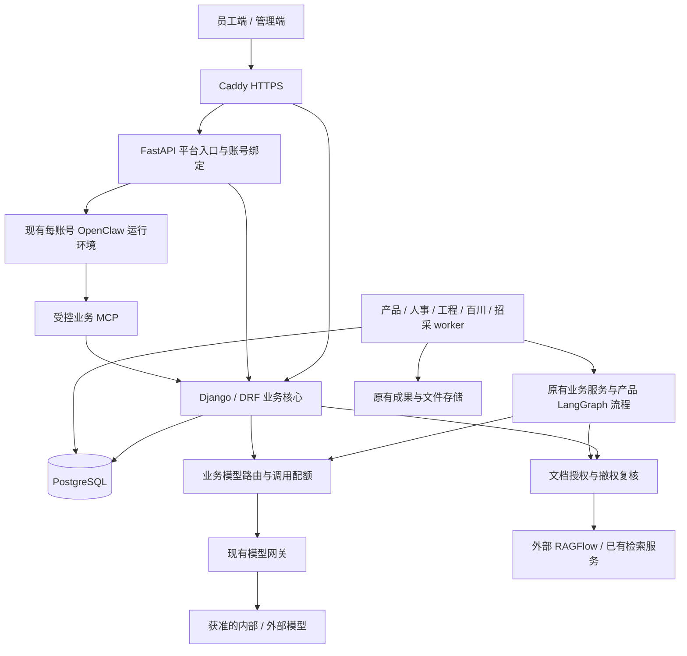

# 企业平台架构与部署边界

更新：2026-10-20。以 MultiUserClaw 的完整业务版本为基底合入权限和恢复改造；迁移结果见 [整合检查](merge-newai-20261020.md)。本文件不构成上线批准。

## 架构

采用模块化业务后端、数据库任务队列与独立 worker。产品、人事、工程、百川及招采共用账号、授权、审计和模型配置，不为每个部门部署一套 Agent 平台。

图中的业务服务、授权和路由是同一业务后端内的模块，不是新增服务。本地统一启动保留五类 worker。现有 Cloud Compose 声明 portal、platform gateway、model-gateway、三个 worker、PostgreSQL、前端与 Caddy，百川和招采的云端声明仍需补齐；`portal-init` 是一次性迁移作业。原有两个数据库保留各自职责，无新增 Redis、Kafka、向量库、授权服务或 Kubernetes 依赖。

## Agent 底座

| 能力 | 当前实现与使用范围 |
| --- | --- |
| 产品三件套 | 原有 LangGraph 固定流程；`DocumentTask.checkpoint` 和任务租约是持久状态来源 |
| 简历筛选、工程报价 | 原有业务任务与 worker，沿用输入校验、归属、版本和成果检查 |
| 通用对话、工具调用 | 保留现有 OpenClaw 隔离运行环境，经受控 MCP 调用业务 API |
| 业务知识助手 | 保留旧目录的 DeepSeek Harness 工具/模型循环，模型和工具回调由业务后端控制；本次未以真实模型生成作验收 |
| DeepAgents Harness | 保留已有独立 Runtime 适配；本次不切换为这套执行流 |

Harness 是 Agent 执行机制的类别，不是必须再加一层服务。现阶段不叠加 Pi、Hermes 或第二套队列；已有确定性业务流程不改成自主 Agent。DeepAgents 的原生部署、许可、恢复与隔离仍须独立验收，`single_host` 只是允许声明的部署方式，不能充当部署成功证据。

## 权限与数据边界

1. **账号与功能**：沿用已有业务账号、角色、模块能力、账号绑定、会话版本和授权版本。管理员配置能力不自动赋予资料正文权限。
2. **文档范围**：`KnowledgeAccessPolicy` 按业务域控制启用；`KnowledgeDocumentGrant` 每条指定资料库、文档及一个接收对象（个人、角色、部门或项目）。项目通过已有 `AgentProject` 和新增成员关系共享资料，不扩大对话或任务访问权。
3. **动作权限**：查看、AI 使用、下载分别记录。当前接入产品与工程检索；人事简历、工程任务及成果仍由原有归属权限管理。本次未新增通用原文下载接口或人事知识库接口。
4. **检索边界**：请求仅携带获准的文档 ID，返回片段再次验证文档归属，调用前后重算授权快照。策略停用、过期、成员撤销或文档范围变化均拒绝使用旧快照。每人每业务域最多 4 个资料库、每库 100 个文档，超过则拒绝，不截断授权。
5. **报告来源**：报告生成取“原有报告来源审批范围 ∩ 当前数据库 AI 授权”，不会把问答资料自动提升为报告来源。
6. **模型出口**：Provider 默认标记外部；经核准才可标记内部。业务路由关闭“允许外部处理”后，仅选择内部 Provider，并在发送前和返回时复核。失败不自动改用外部模型。此标记必须与实际网络和服务商处理环境一致，不提供网络沙箱能力。
7. **通用助手出口**：数据库策略默认不允许向通用助手提供正文。经单独核准后才能启用；产品内部专用模型路由即使打开该开关，也不通过 MCP 导出正文。MCP 在检索前、结果中与检索后均验证允许标记及授权版本。
8. **持续连接**：平台 SSE 在首包前及每 5 秒复核账号、绑定和运行环境；数据库异常时关闭流。撤权不保证追回此前已经发送的内容。

生产环境 `DEBUG=0` 强制数据库知识授权。没有对应策略、策略停用或无有效文档授权时拒绝访问，不回退全库。只有调试环境且完全没有该业务域策略时，保留旧环境映射以兼容本地开发；一旦策略存在，空授权同样拒绝。

后台沿用 Django `/admin/`，新增“资料项目”“资料授权策略”“文档授权”“项目资料成员”，没有再造权限管理前端。配置变更沿用 `ManagedAdmin` 的字段级审计，不在审计里记录正文。

## 上线与升级顺序

部署沿用 [Cloud 操作说明](../deploy/cloud/README.md)。升级应在测试副本排练后执行：

1. 停止接收新任务，等待或受控排空 worker；备份数据库、上传资料和成果，记录当前代码版本。
2. 使用同一版本镜像运行既有 `portal-init init`，先保留旧业务迁移链至 `0046_baichuan_assistant_foundation`，再接入 `0036_model_processing_boundary` → `0037_knowledge_access` → `0038_legacy_product_visibility`。保留已应用名称；新0036依赖旧0046，0038仅对不存在的历史字段执行添加。完成迁移后再启动新版业务进程。Windows 启动脚本不自动迁移，需使用业务环境显式运行 `python manage.py migrate --noinput`。
3. 如需迁移产品问答的旧个人文档映射，运行 `python manage.py import_knowledge_grants` 校验，再运行 `python manage.py import_knowledge_grants --apply` 原子导入。命令拒绝覆盖已有产品策略，拒绝通配符与非精确账号 ID；默认不授权下载和助手正文导出。无旧映射时直接在后台建立显式授权。
4. 工程资料需要人工确认资料库与具体文档，再配置策略及授权；不自动把原部门全库权限复制给所有账号。报告生成仍需原有来源审批配置。
5. 在后台核对 Provider 实际处理边界、业务路由与用户/角色可选模型范围。迁移为兼容已有业务，既有路由默认仍允许外部处理；涉密用途须显式关闭。
6. 重建需要加载新环境的既有服务，验证健康、任务领取、撤权、配额与真实业务下载。仅 `restart` 不会加载 Compose 新环境变量。

回滚不能只撤回表结构：先停用新策略和任务入口，依据备份与版本方案恢复代码及数据，避免让旧代码绕过新授权。不得使用 `down -v` 清空卷作为升级方法。

## 验证与剩余验收

本次改动的测试与迁移证据见 [改造验证记录](architecture-refactor-verification-20261020.md)。已运行的代码检查不替代目标 Linux 镜像构建、公网 TLS、真实模型/RAGFlow 权限联调、真实三件套/简历/报价验收、容量压测及备份恢复演练。正式发布开关和既有审批门槛继续保留。
